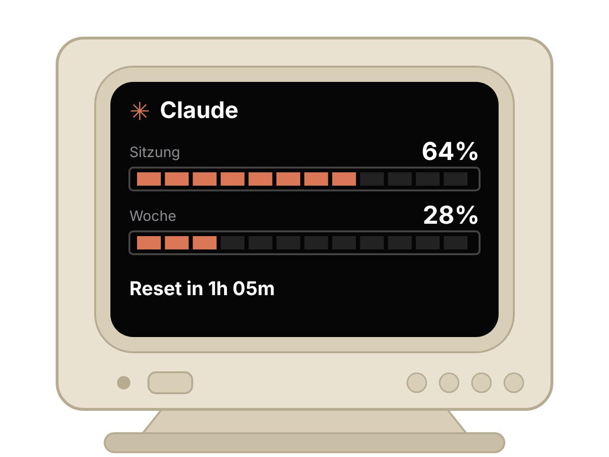

# Claude Usage Monitor Lite 🖥️

## Choose your language · Sprache wählen

Each folder is complete on its own. Pick **one**. · Jeder Ordner ist für sich komplett. Nimm **einen**.

| | Folder · Ordner | Download | Project page · Projektseite |
|---|---|---|---|
| 🇬🇧 **English** | [`en/`](en/) | [ZIP](https://apirz-ai.github.io/claude-usage-monitor-lite/Claude-Usage-Monitor-Lite-English.zip) | [open](https://apirz-ai.github.io/claude-usage-monitor-lite/en/) |
| 🇩🇪 **Deutsch** | [`de/`](de/) | [ZIP](https://apirz-ai.github.io/claude-usage-monitor-lite/Claude-Usage-Monitor-Lite-Deutsch.zip) | [öffnen](https://apirz-ai.github.io/claude-usage-monitor-lite/de/) |

**EN:** The budget version: a tiny 90s-style desk monitor that shows your Claude plan limits. About €16, no battery, touch screen, no soldering, 3D-printed case.

**DE:** Die günstige Variante: ein Mini-Monitor im 90er-Look, der dein Claude-Limit anzeigt. Ca. 16 €, ohne Akku, Touch-Display, kein Löten, Gehäuse aus dem 3D-Drucker.

## Two versions · Zwei Varianten

| | 🔋 With battery · Mit Akku | 💶 Lite (this repo · dieses Repo) |
|---|---|---|
| Price · Preis | ≈ €35 (more expensive · teurer) | ≈ €16 (cheaper · günstiger) |
| Battery · Akku | yes · ja | no, USB power (power bank possible) · nein, USB-Strom (Powerbank möglich) |
| Board | Waveshare ESP32-S3-LCD-1.69 | ESP32-2432S028 ("CYD", 2.8", touch) |
| Repo | [claude-usage-monitor](https://github.com/Apirz-AI/claude-usage-monitor) | claude-usage-monitor-lite |

Both folders contain the same things (guide, print files, device software, setup script, iPhone widget), only the language differs. · In beiden Ordnern steckt dasselbe (Anleitung, Druckdateien, Gerätesoftware, Einrichtungs-Skript, iPhone-Widget), nur die Sprache ist anders.

Status: prototype · Prototyp. Firmware and case dimensions not yet tested on real hardware · Firmware und Gehäusemaße noch nicht an echter Hardware getestet.

MIT License · Idea and development: **A.Pirzadeh** · Not affiliated with Anthropic.
