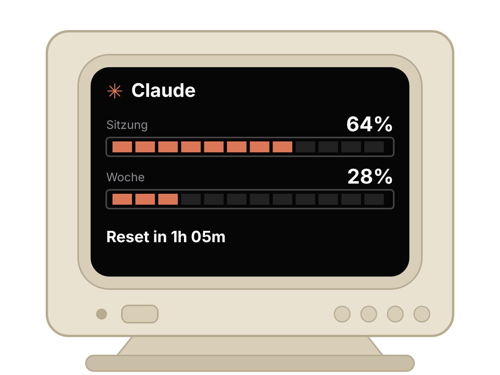
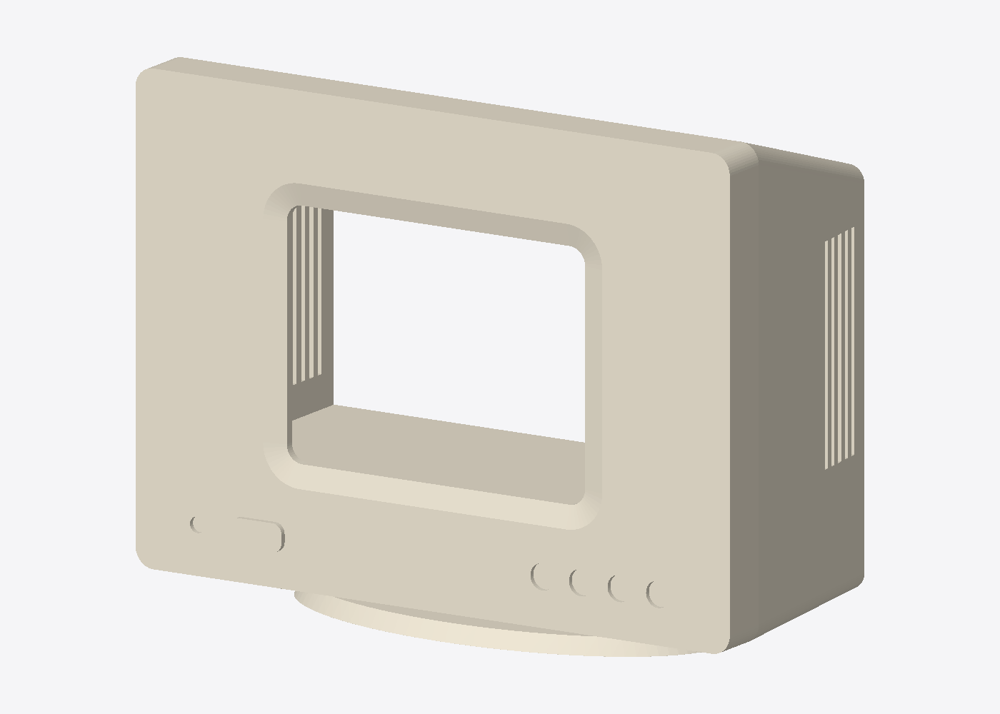

# Claude Usage Monitor Lite 🖥️

🇩🇪 **Deutsch** · 🇬🇧 [English](../en/README.md)

**Die günstige Variante: ein Mini-Computermonitor im 90er-Retro-Look, der dein Claude-Abo-Limit anzeigt. Ohne Akku, mit Touch-Bildschirm. Gesamtkosten: ca. 16 € für das Board.**
Sitzung (5 Stunden), Woche (7 Tage) und wann es wieder zurückgesetzt wird. Strom über ein USB-Kabel, Gehäuse aus dem 3D-Drucker. Kein Löten nötig. Anzeige auf Deutsch oder Englisch.



> **Zwei Varianten, ein Projekt.**
> 🔋 **Mit Akku** (kabellos nutzbar, ca. 35 €): [Claude Usage Monitor](https://github.com/Apirz-AI/claude-usage-monitor) · [Projektseite](https://apirz-ai.github.io/claude-usage-monitor/de/)
> 💶 **Ohne Akku** (Lite, günstiger, ca. 16 €): **diese Seite**. Du steckst ihn ans USB-Netzteil, ein Akku ist nicht dabei. Wer ihn trotzdem mobil braucht, hängt eine Powerbank dran.

> **Für Einsteiger gemacht.** Du musst nicht programmieren und nicht löten können. Folge einfach den Schritten der Reihe nach.

**🌐 Projektseite mit allen Downloads und Ein-Klick-Installation:** [apirz-ai.github.io/claude-usage-monitor-lite](https://apirz-ai.github.io/claude-usage-monitor-lite/de/)

## Schnellstart in 5 Schritten

| | Schritt | Dauer |
|---|---|---|
| 1 | **Teile kaufen**: [Board](https://www.amazon.de/dp/B0H44PR159) (ca. 16 €) | 5 min |
| 2 | **Gehäuse drucken**: 3 Dateien aus `stl/` in den 3D-Drucker | Slicer zeigt die Zeit |
| 3 | **Software aufspielen**: auf der Projektseite einen Knopf klicken | 2 min |
| 4 | **Zusammenbauen**: Board einlegen, Deckel, Fuß | 5 min |
| 5 | **Mit Claude verbinden**: Einrichtungs-Skript am PC, WLAN am Gerät | 10 min |

## Projektstand

| Teil | Stand |
|---|---|
| Teileliste | ✅ fertig |
| Gehäuse (STL) | ✅ fertig konstruiert, Druckdateien fehlerfrei erzeugt · ⏳ Maße nach Datenblatt, **erster Probedruck mit echtem Board steht aus** |
| Firmware (Gerät) | ⏳ geschrieben, **noch nicht auf echter Hardware getestet** (Pinbelegung des üblichen ESP32-2432S028-Boards) |
| iPhone-Widget | ✅ läuft im Alltag |
| Einrichtungs-Skript (Windows) | ✅ läuft im Alltag |

> 🙋 **Tester gesucht!** Du hast das Board schon? Erzähl uns in [Issues](https://github.com/Apirz-AI/claude-usage-monitor-lite/issues), was geklappt hat und was nicht.

> ⚠️ **Inoffizielles Bastelprojekt.** Nicht von Anthropic. Claude Usage Monitor nutzt eine nicht dokumentierte Schnittstelle, die sich jederzeit ändern oder abgeschaltet werden kann. Nutzung auf eigene Verantwortung.

---

## Inhalt

1. [Einkaufsliste](#1-einkaufsliste)
2. [Gehäuse drucken](#2-gehäuse-drucken)
3. [Zusammenbauen](#3-zusammenbauen)
4. [Software aufspielen](#4-software-aufspielen)
5. [Claude-Zugang einrichten](#5-claude-zugang-einrichten)
6. [Bedienung](#6-bedienung)
7. [Bonus: iPhone-Widget](#7-bonus-iphone-widget)
8. [Wenn etwas nicht klappt](#8-wenn-etwas-nicht-klappt)
9. [So funktioniert es](#9-so-funktioniert-es)
10. [Projekt selbst veröffentlichen](#10-projekt-selbst-veröffentlichen)

---

## 1. Einkaufsliste

| Teil | Wofür | Beispiel (Amazon.de) | ca. Preis |
|---|---|---|---|
| **ESP32-2432S028 („CYD“, Cheap Yellow Display)**, 2,8 Zoll, 320 × 240, Touch | Mini-Computer mit WLAN **und** Display in einem | [B0H44PR159](https://www.amazon.de/dp/B0H44PR159) | 16 € |
| **PLA-Filament** in **Cremeweiß / Knochenweiß** (der typische Farbton alter Monitore; Beige oder Hellgrau gehen auch), z. B. eSUN Matte PLA *Cremeweiß* | Gehäuse (ca. 110–150 g nötig) | [B0D7GSSH41](https://www.amazon.de/dp/B0D7GSSH41) | ca. 10 € / kg |
| USB-Kabel (Micro-USB oder USB-C, je nach Board, **mit Datenleitungen**) + 5-V-USB-Netzteil | Strom und Software aufspielen | oft schon vorhanden | – |

Preise: Stand November 2026. Es gibt dieses Board von vielen Händlern, achte auf die Bezeichnung **ESP32-2432S028** und **2,8 Zoll**.

💡 **Tipp:** In Schulen, Makerspaces und Bibliotheken gibt es oft 3D-Drucker **mit** Filament. Frag einfach.

**Und der Akku?** Dieses Board hat **keine** Akku-Elektronik. Für mobile Nutzung steckst du eine kleine **Powerbank** an den USB-Anschluss. Wer einen eingebauten Akku will, nimmt die [Variante mit Akku](https://github.com/Apirz-AI/claude-usage-monitor).

---

## 2. Gehäuse drucken

Das Gehäuse sieht aus wie ein Röhrenmonitor der 90er: Front im Format 4:3, Bild mittig, breites Kinn mit vier Reglern, LED und Netzschalter, tiefer Rücken mit Lüftungsschlitzen und ovaler Standfuß. Gleicher Aufbau wie beim [Modell mit Akku](https://github.com/Apirz-AI/claude-usage-monitor), nur größer, weil Board und Display größer sind.



Es gibt **zwei Varianten**, je nachdem auf welcher Seite die USB-Buchse deines Boards im Querformat sitzt. Das Kabel steckt seitlich durch eine Öffnung direkt in der Buchse.

| | **„USB links“** (Standard) | **„USB rechts“** |
|---|---|---|
| USB-Buchse im Querformat | links | rechts |
| Kabel | geht **links** seitlich raus, jedes normale Kabel | geht **rechts** seitlich raus, jedes normale Kabel |
| Firmware-Knopf auf der Projektseite | „USB links“ | „USB rechts“ |
| Größe (B × H × T) | ca. 116 × 91 × 51 mm | ca. 116 × 91 × 51 mm |

> Nach unserem Kenntnisstand passt **„USB links“** zum Standardfall. Ob es bei deinem Board stimmt, siehst du beim ersten Einschalten: Steht das Bild auf dem Kopf, nimm die andere Seite.
> Tipp: **Erst die Software aufspielen und testen, dann drucken.** So weißt du, welche Seite du brauchst.

**Dateien** (Ordner [`stl/`](stl/), druckfertig):

| Teil | Variante „USB links“ | Variante „USB rechts“ |
|---|---|---|
| Gehäuse | [`usagemonitor_usb-links_gehaeuse.stl`](stl/usagemonitor_usb-links_gehaeuse.stl) | [`usagemonitor_usb-rechts_gehaeuse.stl`](stl/usagemonitor_usb-rechts_gehaeuse.stl) |
| Rückdeckel | [`usagemonitor_usb-links_deckel.stl`](stl/usagemonitor_usb-links_deckel.stl) | [`usagemonitor_usb-rechts_deckel.stl`](stl/usagemonitor_usb-rechts_deckel.stl) |
| Standfuß | [`usagemonitor_usb-links_fuss.stl`](stl/usagemonitor_usb-links_fuss.stl) | [`usagemonitor_usb-rechts_fuss.stl`](stl/usagemonitor_usb-rechts_fuss.stl) |

Maße anpassen: [OpenSCAD](https://openscad.org) (kostenlos) installieren → `enclosure/usagemonitor_gehaeuse.scad` öffnen → oben `usb` und `teil` einstellen → **F6** → *Datei → Exportieren → STL*. Die Vorschau (**F5**) zeigt das Gehäuse in der Filamentfarbe (Wert `farbe` oben in der Datei).

### So kommt die Datei auf den Drucker (für Einsteiger)

Ein 3D-Drucker kann eine STL-Datei nicht direkt drucken. Dazwischen kommt ein **Slicer**: ein Programm, das das 3D-Modell in hauchdünne Schichten „schneidet“ und daraus die Fahrbefehle für den Drucker macht (**G-Code**). Vergleich: Die STL ist der Bauplan, der G-Code ist die Arbeitsanweisung für den Handwerker.

1. **Druckermodell herausfinden** (steht vorne oder hinten am Drucker).
2. **Passenden Slicer öffnen**:
   - Prusa → [PrusaSlicer](https://www.prusa3d.com/page/prusaslicer_424/)
   - Bambu Lab → [Bambu Studio](https://bambulab.com/de/download/studio)
   - Creality → [Creality Print](https://www.creality.com/pages/download) oder [OrcaSlicer](https://github.com/SoftFever/OrcaSlicer)
   - Andere → [UltiMaker Cura](https://ultimaker.com/software/ultimaker-cura/)
3. Oben den **richtigen Drucker** und **PLA** als Material wählen.
4. Die drei STL-Dateien deiner Seite **hineinziehen** (Drag & Drop).
5. Teile richtig **hinlegen** (Tabelle unten). „Auf Fläche legen“ / „Lay on face“ hilft.
6. Einstellungen aus der Tabelle setzen, **Stützstrukturen aus**.
7. **„Slicen“** klicken. Der Slicer zeigt Druckzeit und Filamentverbrauch an (ca. 110–150 g).
8. **G-Code exportieren** (SD-Karte, USB-Stick) oder bei WLAN-Druckern direkt **„Drucken“**.
9. Die **erste Schicht** beobachten. Haftet sie sauber, läuft der Rest von allein.
10. Teile abkühlen lassen und vorsichtig von der Platte lösen.

**Druckeinstellungen:**

| | |
|---|---|
| Material | PLA, alle Teile in **einer Farbe** |
| Schichthöhe | 0,2 mm |
| Füllung | 15 % |
| Stützstrukturen | **keine** |
| Gehäuse | Bildschirmseite **nach unten** aufs Druckbett |
| Deckel | flach, die Lippe zeigt nach oben |
| Standfuß | flach, breite Seite unten |

**Passt nicht?** Die Maße stammen aus Datenblättern. Miss dein Board mit einem Messschieber nach und ändere oben in der `.scad`-Datei die Werte im Abschnitt *MASSE DER BAUTEILE*. Danach neu exportieren. Bitte melde uns in den [Issues](https://github.com/Apirz-AI/claude-usage-monitor-lite/issues), welche Werte bei dir gestimmt haben.

---

## 3. Zusammenbauen

> Spiel die Software am besten **vorher** auf (Abschnitt 4), solange das Board noch frei zugänglich ist. Du brauchst kein Werkzeug.

1. **Teile säubern:** Fäden und Ränder vom Druck vorsichtig abziehen, besonders an der Bildöffnung und an der USB-Öffnung.
2. **Gehäuse mit der Front nach unten** auf den Tisch legen (weiches Tuch drunter).
3. **Board von hinten einlegen**, Display nach unten zur Bildöffnung. Das Display-Glas rutscht in die passende Tasche. Die **USB-Buchse** liegt genau an der **seitlichen Öffnung**.
4. **Prüfen:** Von vorne gesehen sitzt das Bild mittig und gerade im Rahmen? Liegt das Glas plan auf? Nichts mit Gewalt drücken.
5. **USB-Kabel** von der Seite einstecken. Der Stecker muss ganz in die Buchse gehen, ohne am Gehäuse anzustoßen.
6. **Deckel** hinten aufstecken. Er hält durch Klemmung. Die zwei Leisten drücken das Board sanft nach vorne. Wackelt das Board noch, ein Stück Schaumstoff oder Klebepad zwischen Leiste und Board legen.
7. Gehäuse auf den **Standfuß** stecken.
8. Netzteil einstecken: Das Bild erscheint nach wenigen Sekunden.

---

## 4. Software aufspielen

Das nennt man **Flashen**: Die Software wird auf den kleinen Computer gespielt. Das ist wie ein Betriebssystem auf einen neuen PC installieren.

### Einfach: im Browser (empfohlen)

1. Board per USB an den Computer stecken (Kabel **mit Datenleitungen**).
2. Die [**Projektseite**](https://apirz-ai.github.io/claude-usage-monitor-lite/de/) in **Chrome** oder **Edge** öffnen (Safari und Firefox können das nicht).
3. Auf **„Installieren · USB links“** klicken → das Gerät auswählen → **Install**. Steht das Bild später auf dem Kopf, nimm **„USB rechts“**.
4. Warten, bis „Installation complete“ erscheint. Fertig.

**Windows findet das Gerät nicht?** Das Board nutzt einen CH340- oder CP210x-Chip. Installiere bei Bedarf den Treiber des Herstellers (Suche: „CH340 Treiber“ bzw. „CP210x Treiber“) und starte Chrome neu.
**Verbindung klappt trotzdem nicht?** Die **BOOT**-Taste (auf der Rückseite des Boards) gedrückt halten, kurz **RST** drücken, BOOT loslassen. Dann noch einmal versuchen.

### Für Fortgeschrittene: Arduino IDE

1. [Arduino IDE](https://www.arduino.cc/en/software) installieren.
2. *Datei → Einstellungen → Zusätzliche Boardverwalter-URLs:*
   `https://espressif.github.io/arduino-esp32/package_esp32_index.json`
3. *Werkzeuge → Board → Boardverwalter*: **esp32** von Espressif installieren.
4. *Bibliotheksverwalter*: **LovyanGFX**, **ArduinoJson** und **WiFiManager** (von tzapu) installieren.
5. `firmware/UsageMonitor/UsageMonitor.ino` öffnen.
6. *Werkzeuge*: Board **ESP32 Dev Module**, *Partition Scheme*: **Huge APP**.
7. Port wählen → **Hochladen** (Pfeil-Symbol).

---

## 5. Claude-Zugang einrichten

Das Gerät braucht einen **eigenen** Zugang zu deinem Claude-Konto, um die Werte abzufragen. Den holst du einmalig am Windows-PC.

> **Warum ein eigener Zugang pro Gerät?** Der Zugang funktioniert mit einem **Refresh-Token**. Das ist wie ein Ausweis, mit dem man sich jeden Tag eine neue Tageskarte holt. Bei jedem Abholen wird der alte Ausweis ungültig und es gibt einen neuen. Nutzen zwei Geräte denselben Ausweis, sperren sie sich gegenseitig aus. Deshalb: **ein Gerät = eine Anmeldung.**

### Schritt für Schritt (Windows)

1. **Claude Code installieren** (einmalig). PowerShell öffnen (Windows-Taste → „PowerShell“ eintippen → Enter) und einfügen:
   ```powershell
   irm https://claude.ai/install.ps1 | iex
   ```
2. **Einrichtungs-Skript** [`UsageMonitor-Einrichtung.ps1`](setup/UsageMonitor-Einrichtung.ps1) herunterladen (auch auf der [Projektseite](https://apirz-ai.github.io/claude-usage-monitor-lite/de/)) und starten:
   ```powershell
   powershell -ExecutionPolicy Bypass -File "$env:USERPROFILE\Downloads\UsageMonitor-Einrichtung.ps1"
   ```
   *ExecutionPolicy Bypass* erlaubt nur **dieses eine** Skript **dieses eine Mal**. Deine Sicherheitseinstellungen bleiben, wie sie sind.
3. Das Skript startet bei Bedarf Claude Code. Dort:
   - Ordnerfrage: **„Yes, I trust this folder“**
   - `/login` eintippen → **„Claude account with subscription“** → im Browser **erlauben**
   - Bei „Login successful“: `/exit` eintippen
4. Im Skript **[2] Usage-Monitor-Gerät** wählen. Der Token liegt jetzt in der Zwischenablage.
5. **Gerät einschalten** (USB anstecken). Auf dem Bildschirm steht **„Einrichtung“**.
6. Mit Handy oder Laptop das WLAN **`UsageMonitor-Setup`** auswählen. Es öffnet sich eine Seite (falls nicht: im Browser `192.168.4.1` aufrufen).
7. **Configure WiFi** → dein WLAN wählen → Passwort eingeben → im Feld **Claude Refresh-Token** mit **Strg + V** einfügen → **Save**.
8. Nach wenigen Sekunden erscheinen deine Werte. Im Skript **Enter** drücken. Fertig! 🎉

> 🔒 **Der Token ist wie ein Schlüssel zu deinem Claude-Konto.** Nicht weitergeben, nicht in Chats oder Screenshots posten.

**Mac/Linux:** Das Skript gibt es bisher nur für Windows. Nach dem Login mit Claude Code steht der Refresh-Token in `~/.claude/.credentials.json` (Mac: im Schlüsselbund, Eintrag „Claude Code-credentials“) unter `refreshToken`. Diesen Wert in Schritt 7 einfügen und die Datei danach umbenennen.

---

## 6. Bedienung

| Was | Wie |
|---|---|
| **Einschalten / Ausschalten** | USB-Kabel anstecken bzw. abziehen (es gibt keinen Schalter) |
| **Sofort neu laden** | Bildschirm **kurz antippen** (oder **BOOT**-Taste kurz drücken) |
| **Alles zurücksetzen** (WLAN + Anmeldung) | Bildschirm **10 Sekunden** gedrückt halten. Nach 3 Sekunden erscheint ein Hinweis, vorher loslassen = abbrechen |

Die Knöpfe, der Schalter und der Punkt **vorne im Kinn** sind nur Deko im Monitor-Stil.

**Anzeige:**
- **Sitzung**: dein 5-Stunden-Limit. Darunter siehst du, wann es zurückgesetzt wird.
- **Woche**: dein 7-Tage-Limit.
- Balkenfarbe: Orange = normal, Gelb-Orange ab 75 %, Rot ab 90 %.
- Die Werte werden alle **2 Minuten** aktualisiert.

---

## 7. Bonus: iPhone-Widget

Dieselben Werte als Widget auf dem iPhone-Home- oder Sperrbildschirm.

1. App **Scriptable** (kostenlos) aus dem App Store installieren.
2. [`widget/ClaudeUsage.js`](widget/ClaudeUsage.js) aufs iPhone holen und in **iCloud Drive → Scriptable** speichern. Der Name muss genau `ClaudeUsage.js` sein (nicht `.txt`).
3. Am PC das Einrichtungs-Skript starten → **[1] iPhone-Widget** → QR-Code mit der iPhone-Kamera scannen → **„In Scriptable öffnen“** → „Verbunden ✓“.
4. Widget hinzufügen: Homescreen lange drücken → **Bearbeiten** → **Widget hinzufügen** → **Scriptable** → antippen → Script **ClaudeUsage**.

Auch das iPhone braucht eine **eigene** Anmeldung, also das Skript für jedes Gerät einmal starten.

---

## 8. Wenn etwas nicht klappt

| Problem | Lösung |
|---|---|
| PowerShell: *„claude“ wurde nicht erkannt* | Das Einrichtungs-Skript sucht Claude Code selbst. Sonst PowerShell schließen, neu öffnen und erneut versuchen. |
| Download der `.ps1`-Datei wird blockiert | Im Browser „Behalten“ wählen. Oder den Inhalt von der Webseite kopieren und in eine Datei `UsageMonitor-Einrichtung.ps1` speichern. |
| Computer erkennt das Board nicht | Anderes Kabel probieren (manche laden nur). Treiber CH340/CP210x installieren. BOOT halten, RST drücken. |
| Bildschirm bleibt nach der Installation weiß oder schwarz | Manche Boards haben einen anderen Display-Chip (ST7789 statt ILI9341). In `config.h` die Zeile `#define DISPLAY_ST7789` aktivieren, `DISPLAY_INVERT` auf `true` stellen und mit der Arduino IDE neu aufspielen. Bitte in den Issues melden. |
| Farben sehen „negativ“ aus oder Rot/Blau vertauscht | In `config.h` `DISPLAY_INVERT` bzw. `DISPLAY_RGB_ORDER` umstellen (`true`/`false`). |
| Bild steht auf dem Kopf | Auf der Webseite die **andere** USB-Seite aufspielen (und das passende Gehäuse drucken), oder in `config.h` `DISPLAY_ROTATION` zwischen `1` und `3` wechseln. |
| Tippen reagiert nicht | Stattdessen die BOOT-Taste (Rückseite) benutzen. Bitte in den Issues melden. |
| Anzeige in der falschen Sprache | Den englischen Ordner erwischt? Die Software aus dem Ordner `de/` installieren, oder in `config.h` `LANGUAGE_EN` auf `0` (Deutsch) bzw. `1` (Englisch). |
| Anzeige: **„Anmeldung abgelaufen“** | Der Zugang wurde woanders benutzt. Einrichtungs-Skript neu starten, neuen Token holen, Gerät verbindet sich automatisch mit `UsageMonitor-Setup`. |
| Anzeige: **„WLAN getrennt“** | Router prüfen. Neues WLAN: Bildschirm 10 Sekunden halten und neu einrichten. |
| Unregelmäßige Fehler beim Abrufen | In `config.h` ist `SPRITE_BITS` auf `8` gestellt (spart Speicher). Falls du es auf `16` gestellt hast: zurück auf `8`. |
| Sitzung zeigt **„Keine Sitzung“** | Normal, wenn gerade kein 5-Stunden-Fenster läuft. |
| USB-Stecker passt nicht durch die Seitenöffnung | In der `.scad`-Datei `usb_oeff_b` / `usb_oeff_t` größer machen und neu drucken. |
| Board passt nicht ins Gehäuse | Maße in der `.scad`-Datei anpassen (Abschnitt 2). |

---

## 9. So funktioniert es

Kurz erklärt, damit du mitreden kannst:

- **ESP32**: Ein Mikrocontroller, also ein winziger Computer auf einem Chip mit eingebautem WLAN. Er ist wie das Gehirn des Geräts.
- **API / Endpunkt**: Eine feste Internetadresse, die Daten statt einer Webseite liefert. Wie ein Automat: Man drückt eine Nummer und bekommt genau ein Getränk. Hier liefert sie dein Limit als Zahlen.
- **OAuth / Token**: Statt deines Passworts bekommt das Gerät einen **Access-Token** (Tageskarte, läuft nach Stunden ab) und einen **Refresh-Token** (Ausweis, um neue Tageskarten zu holen). Dein Passwort verlässt nie deinen PC.
- **Captive Portal**: Die Einrichtungsseite, die sich automatisch öffnet, wenn du dich mit `UsageMonitor-Setup` verbindest. Wie das WLAN-Login im Hotel.
- **SPI / ILI9341 / XPT2046**: SPI ist die Datenleitung. ILI9341 ist der Chip im Display, XPT2046 der Chip, der dein Tippen erkennt.

**Ablauf:** Alle 2 Minuten holt sich das Gerät bei Bedarf eine neue Tageskarte, fragt damit die Verbrauchswerte ab und zeichnet sie auf das Display. Der Countdown läuft dazwischen über die Internetzeit (NTP) weiter.

**Was ist was? (Dateien im Projekt)**

| Datei / Ordner | Was es ist | Brauchst du es? |
|---|---|---|
| `de/` | Alles auf Deutsch: diese Anleitung und die Projektseite | ✅ Start hier |
| `en/` | Dasselbe auf Englisch | – |
| `stl/` | Die 6 fertigen Druckdateien (je USB-Seite 3 Teile) | ✅ zum Drucken |
| `setup/UsageMonitor-Einrichtung.ps1` | Windows-Skript: holt den Claude-Zugang für dein Gerät | ✅ einmal pro Gerät |
| `widget/ClaudeUsage.js` | Bonus: dasselbe als iPhone-Widget | optional |
| `firmware/` | Der Quellcode der Gerätesoftware | nur zum Ändern |
| `enclosure/` | Die Gehäuse-Quelle (OpenSCAD) | nur zum Ändern |
| `web/` | Zubehör der Projektseite | nein |
| `docs/` | Bilder für diese Anleitung | nein |
| `.github/` | Bau-Automatik: übersetzt die Firmware und erzeugt die Druckdateien | nein |

---

## 10. Projekt selbst veröffentlichen

So stellst du eine eigene, angepasste Kopie auf GitHub online (oben rechts **Fork** geht auch). Die Firmware und die STL-Dateien werden dann **automatisch** gebaut.

1. Kostenloses Konto auf [github.com](https://github.com) anlegen.
2. Oben rechts **+ → New repository** → Name `claude-usage-monitor-lite` → **Public** → **Create**.
3. **„uploading an existing file“** anklicken → alle Dateien und Ordner aus diesem Projekt hineinziehen → **Commit changes**.
   Wichtig: Der versteckte Ordner `.github` muss mit hoch. Falls er beim Ziehen fehlt: **Add file → Create new file**, als Namen `.github/workflows/build.yml` eintippen und den Inhalt hineinkopieren.
4. **Settings → Pages → Source: „GitHub Actions“** einstellen.
5. Oben auf **Actions** klicken und warten, bis der Lauf grün ist (ca. 5–10 Minuten).
6. Die Webseite steht dann unter `https://DEINNAME.github.io/claude-usage-monitor-lite/`. Dort sind Browser-Flasher, STL-Dateien und Skript.

---

## Lizenz

MIT, siehe [LICENSE](LICENSE). Du darfst alles nutzen, ändern und weitergeben.

Idee und Entwicklung: **A.Pirzadeh**

*Claude ist eine Marke von Anthropic. Dieses Projekt steht in keiner Verbindung zu Anthropic.*
