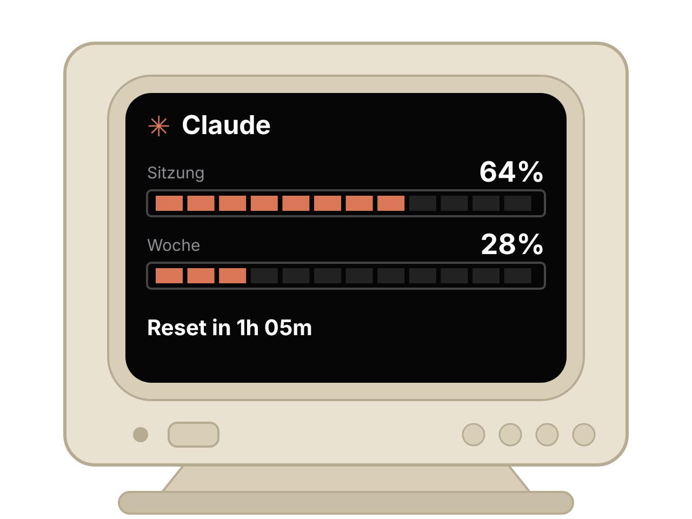

# Claude Usage Monitor Lite 🖥️

🇬🇧 **English** · 🇩🇪 [Deutsch](../de/README.md)

**The budget version: a tiny 90s-style desk monitor that shows your Claude plan limits. No battery, touch screen. About €16 for the board.**
Session (5 hours), week (7 days) and when it resets. Powered over a USB cable, case from a 3D printer. No soldering. Display in English or German.



> **Two versions, one project.**
> 🔋 **With battery** (cordless use, about €35): [Claude Usage Monitor](https://github.com/Apirz-AI/claude-usage-monitor) · [project page](https://apirz-ai.github.io/claude-usage-monitor/en/)
> 💶 **Without battery** (Lite, cheaper, about €16): **this page**. You plug it into a USB charger, no battery included. If you need it mobile, attach a power bank.

> **Made for beginners.** No programming or soldering skills needed. Just follow the steps in order.

**🌐 Project page with all downloads and one-click install:** [apirz-ai.github.io/claude-usage-monitor-lite](https://apirz-ai.github.io/claude-usage-monitor-lite/en/)

## Quick start in 5 steps

| | Step | Time |
|---|---|---|
| 1 | **Buy the part**: [board](https://www.amazon.de/dp/B0H44PR159) (about €16) | 5 min |
| 2 | **Print the case**: 3 files from `stl/` | about 4 h |
| 3 | **Install the software**: click one button on the project page | 2 min |
| 4 | **Assemble**: insert board, lid, stand | 5 min |
| 5 | **Connect to Claude**: setup script on your PC, Wi-Fi on the device | 10 min |

## Project status

| Part | Status |
|---|---|
| Parts list | ✅ done |
| Case (STL) | ⏳ designed from datasheets, **dimensions not yet checked on a real board**, first test print pending |
| Firmware (device) | ⏳ written, **not yet tested on real hardware** (pin layout of the common ESP32-2432S028 board) |
| iPhone widget | ✅ in daily use |
| Setup script (Windows) | ✅ in daily use |

> 🙋 **Testers wanted!** Already have the board? Tell us in [Issues](https://github.com/Apirz-AI/claude-usage-monitor-lite/issues) what worked and what didn't.

> ⚠️ **Unofficial hobby project.** Not from Anthropic. Claude Usage Monitor uses an undocumented interface that can change or be shut off at any time. Use at your own risk.

---

## Contents

1. [Shopping list](#1-shopping-list)
2. [Print the case](#2-print-the-case)
3. [Assemble](#3-assemble)
4. [Install the software](#4-install-the-software)
5. [Set up Claude access](#5-set-up-claude-access)
6. [Operation](#6-operation)
7. [Bonus: iPhone widget](#7-bonus-iphone-widget)
8. [Troubleshooting](#8-troubleshooting)
9. [How it works](#9-how-it-works)

---

## 1. Shopping list

| Part | Purpose | Example (Amazon.de) | approx. price |
|---|---|---|---|
| **ESP32-2432S028 ("CYD", Cheap Yellow Display)**, 2.8 inch, 320 × 240, touch | Tiny computer with Wi-Fi **and** display in one | [B0H44PR159](https://www.amazon.de/dp/B0H44PR159) | €16 |
| **PLA filament**, one colour (cream white, beige or light grey) | Case (about 60 g needed) | any | about €10 / kg |
| USB cable (Micro-USB or USB-C depending on the board, **with data lines**) + 5 V USB charger | Power and installing the software | usually already at home | – |

Prices: November 2026. Many shops sell this board; look for **ESP32-2432S028** and **2.8 inch**.

💡 **Tip:** Schools, makerspaces and libraries often have 3D printers **with** filament. Just ask.

**What about a battery?** This board has **no** battery electronics. For mobile use, plug a small **power bank** into the USB port. If you want a built-in battery, use the [version with battery](https://github.com/Apirz-AI/claude-usage-monitor).

---

## 2. Print the case

There are **two variants**, depending on which side the USB socket of your board is on when it is in landscape. The cable leaves through an opening in the side.

| File set | USB socket in landscape | Firmware button |
|---|---|---|
| `usagemonitor_usb-links_*` | left | "USB left" |
| `usagemonitor_usb-rechts_*` | right | "USB right" |

> To our knowledge **"USB left"** fits the standard case. Whether that is true for your board, you see at the first power-up: if the picture is upside down, take the other side.
> Tip: **Install and test the software first, then print.** That way you know which side you need.

**Files:** The [`stl/`](stl/) folder holds the ready-to-print parts, three files per side: **case**, **back lid** and **stand**.

Change dimensions: install [OpenSCAD](https://openscad.org) (free) → open `enclosure/usagemonitor_gehaeuse.scad` → set `usb` and `teil` at the top → **F6** → *File → Export → STL*.

### How the file gets to the printer (for beginners)

A 3D printer cannot print an STL file directly. In between sits a **slicer**: a program that "slices" the 3D model into hair-thin layers and turns them into movement commands for the printer (**G-code**). Think of the STL as the blueprint and the G-code as the work order for the craftsman.

1. **Find your printer model** (printed on the front or back of the printer).
2. **Open the matching slicer:**
   - Prusa → [PrusaSlicer](https://www.prusa3d.com/page/prusaslicer_424/)
   - Bambu Lab → [Bambu Studio](https://bambulab.com/en/download/studio)
   - Creality → [Creality Print](https://www.creality.com/pages/download) or [OrcaSlicer](https://github.com/SoftFever/OrcaSlicer)
   - Others → [UltiMaker Cura](https://ultimaker.com/software/ultimaker-cura/)
3. Choose the **right printer** and **PLA** as material at the top.
4. **Drag** the three STL files of your side into the slicer.
5. **Lay the parts down** correctly (table below). "Lay on face" helps.
6. Apply the settings from the table, **supports off**.
7. Click **"Slice"**. The slicer shows print time and filament use (about 4 hours, about 60 g).
8. **Export the G-code** (SD card, USB stick) or press **"Print"** on Wi-Fi printers.
9. Watch the **first layer**. If it sticks cleanly, the rest runs by itself.
10. Let the parts cool and remove them carefully from the plate.

**Print settings:**

| | |
|---|---|
| Material | PLA, all parts in **one colour** |
| Layer height | 0.2 mm |
| Infill | 15 % |
| Supports | **none** |
| Case | screen side **down** on the bed |
| Lid | flat, lip facing up |
| Stand | flat, wide side down |

**Doesn't fit?** The dimensions come from datasheets. Measure your board with a caliper and change the values in the *MASSE DER BAUTEILE* (component dimensions) section at the top of the `.scad` file. Then export again. Please tell us in [Issues](https://github.com/Apirz-AI/claude-usage-monitor-lite/issues) which values were right for you.

---

## 3. Assemble

> Install the software **first** (section 4) while the board is still easy to reach.

1. Place the **board from the back** into the case: the display faces the front window and sits in the pocket. The USB socket is at the side opening.
2. Plug the cable in from the side and check that nothing jams.
3. Push the **lid** onto the back. It holds by friction. The two ribs press the board gently forward.
4. Put the case on the **stand**.

---

## 4. Install the software

This is called **flashing**: the software is loaded onto the little computer, like installing an operating system on a new PC.

### Easy: in the browser (recommended)

1. Connect the board to your computer by USB (cable **with data lines**).
2. Open the [**project page**](https://apirz-ai.github.io/claude-usage-monitor-lite/en/) in **Chrome** or **Edge** (Safari and Firefox can't do this).
3. Click **"Install · USB left"** → choose the device → **Install**. If the picture is upside down later, use **"USB right"**.
4. Wait for "Installation complete". Done.

**Windows can't find the device?** The board uses a CH340 or CP210x chip. Install the manufacturer driver if needed (search "CH340 driver" or "CP210x driver") and restart Chrome.
**Still no connection?** Hold the **BOOT** button (back of the board), tap **RST**, release BOOT. Try again.

### For advanced users: Arduino IDE

1. Install the [Arduino IDE](https://www.arduino.cc/en/software).
2. *File → Preferences → Additional boards manager URLs:*
   `https://espressif.github.io/arduino-esp32/package_esp32_index.json`
3. *Tools → Board → Boards Manager*: install **esp32** by Espressif.
4. *Library Manager*: install **LovyanGFX**, **ArduinoJson** and **WiFiManager** (by tzapu).
5. Open `firmware/UsageMonitor/UsageMonitor.ino`.
6. *Tools*: Board **ESP32 Dev Module**, *Partition Scheme*: **Huge APP**.
7. Pick the port → **Upload** (arrow icon).

---

## 5. Set up Claude access

The device needs its **own** access to your Claude account to read the values. You get it once on a Windows PC.

> **Why a separate login per device?** Access works with a **refresh token**. Think of it as an ID card you use to fetch a new day pass every day. Each time you fetch one, the old ID becomes invalid and you get a new one. If two devices share one ID they lock each other out. So: **one device = one login.**

### Step by step (Windows)

1. **Install Claude Code** (once). Open PowerShell (Windows key → type "PowerShell" → Enter) and paste:
   ```powershell
   irm https://claude.ai/install.ps1 | iex
   ```
2. Download the **setup script** [`UsageMonitor-Einrichtung.ps1`](setup/UsageMonitor-Einrichtung.ps1) (also on the [project page](https://apirz-ai.github.io/claude-usage-monitor-lite/en/)) and run it:
   ```powershell
   powershell -ExecutionPolicy Bypass -File "$env:USERPROFILE\Downloads\UsageMonitor-Einrichtung.ps1"
   ```
   *ExecutionPolicy Bypass* allows only **this one** script **this one time**. Your security settings stay as they are.
3. The script starts Claude Code if needed. There:
   - Folder question: **"Yes, I trust this folder"**
   - Type `/login` → **"Claude account with subscription"** → **allow** in the browser
   - On "Login successful": type `/exit`
4. In the script choose **[2] Usage monitor device**. The token is now in your clipboard.
5. **Switch the device on** (plug in USB). The screen says **"Setup"**.
6. On your phone or laptop pick the Wi-Fi **`UsageMonitor-Setup`**. A page opens (if not: open `192.168.4.1` in the browser).
7. **Configure WiFi** → choose your Wi-Fi → enter the password → paste into **Claude refresh token** with **Ctrl + V** → **Save**.
8. After a few seconds your values appear. Press **Enter** in the script. Done! 🎉

> 🔒 **The token is like a key to your Claude account.** Don't share it and don't post it in chats or screenshots.

**Mac/Linux:** The script exists for Windows only so far. After logging in with Claude Code, the refresh token is in `~/.claude/.credentials.json` (Mac: in Keychain, entry "Claude Code-credentials") under `refreshToken`. Paste that value in step 7 and rename the file afterwards.

---

## 6. Operation

| What | How |
|---|---|
| **Power on / off** | Plug in or unplug the USB cable (there is no switch) |
| **Refresh now** | **Tap the screen briefly** (or press the **BOOT** button briefly) |
| **Reset everything** (Wi-Fi + login) | Hold the screen for **10 seconds**. After 3 seconds a hint appears; release before 10 s = cancel |

The knobs, the switch and the dot **on the front chin** are only monitor-style decoration.

**Display:**
- **Session**: your 5-hour limit. Below it you see when it resets.
- **Week**: your 7-day limit.
- Bar colour: orange = normal, amber from 75 %, red from 90 %.
- Values refresh every **2 minutes**.

---

## 7. Bonus: iPhone widget

The same values as a widget on your iPhone home or lock screen.

1. Install the free **Scriptable** app from the App Store.
2. Get [`widget/ClaudeUsage.js`](widget/ClaudeUsage.js) onto the iPhone and save it in **iCloud Drive → Scriptable**. The name must be exactly `ClaudeUsage.js` (not `.txt`).
3. On the PC run the setup script → **[1] iPhone widget** → scan the QR code with the iPhone camera → **"Open in Scriptable"** → "Connected ✓".
4. Add the widget: long-press the home screen → **Edit** → **Add Widget** → **Scriptable** → tap it → script **ClaudeUsage**.

The iPhone also needs its **own** login, so run the script once per device.

---

## 8. Troubleshooting

| Problem | Solution |
|---|---|
| Computer doesn't detect the board | Try another cable (some only charge). Install the CH340/CP210x driver. Hold BOOT, tap RST. |
| Screen stays white or black after install | Some boards use a different display chip (ST7789 instead of ILI9341). In `config.h` enable the line `#define DISPLAY_ST7789`, set `DISPLAY_INVERT` to `true` and reflash with the Arduino IDE. Please report it in Issues. |
| Colours look like a negative, or red/blue swapped | In `config.h` switch `DISPLAY_INVERT` or `DISPLAY_RGB_ORDER` (`true`/`false`). |
| Picture is upside down | Flash the **other** USB side from the web page (and print the matching case), or switch `DISPLAY_ROTATION` between `1` and `3` in `config.h`. |
| Touch doesn't respond | Use the BOOT button (back) instead. Please report it in Issues. |
| Wrong display language | Got the German folder? Install the software from the `en/` folder, or set `LANGUAGE_EN` in `config.h` to `1` (English) or `0` (German). |
| Display says **"Login expired"** | The access was used elsewhere. Restart the setup script, get a new token; the device joins `UsageMonitor-Setup` automatically. |
| Display says **"Wi-Fi lost"** | Check your router. New Wi-Fi: hold the screen 10 seconds and set up again. |
| Sporadic errors when fetching | `SPRITE_BITS` in `config.h` is `8` (saves memory). If you set it to `16`, change it back to `8`. |
| Session shows **"No session"** | Normal when no 5-hour window is running. |
| Board doesn't fit the case | Adjust dimensions in the `.scad` file (section 2). |

---

## 9. How it works

- **ESP32**: A microcontroller, a tiny computer on a chip with built-in Wi-Fi. It is the brain of the device.
- **API / endpoint**: A fixed internet address that returns data instead of a web page. Here it returns your limit as numbers.
- **OAuth / token**: Instead of your password the device gets an **access token** (day pass, expires after hours) and a **refresh token** (ID card to get new day passes). Your password never leaves your PC.
- **Captive portal**: The setup page that opens automatically when you join `UsageMonitor-Setup`. Like hotel Wi-Fi login.
- **SPI / ILI9341 / XPT2046**: SPI is the data line. ILI9341 is the chip in the display, XPT2046 the chip that detects your tap.

**Flow:** Every 2 minutes the device gets a new day pass if needed, asks for the usage values and draws them on the display. In between the countdown runs on internet time (NTP).

**What is what? (files in the project)**

| File / folder | What it is | Do you need it? |
|---|---|---|
| `en/` | Everything in English: this guide and the project page | ✅ Start here |
| `de/` | The same in German | – |
| `stl/` | The 6 ready print files (3 parts per USB side) | ✅ for printing |
| `setup/UsageMonitor-Einrichtung.ps1` | Windows script: gets the Claude access for your device | ✅ once per device |
| `widget/ClaudeUsage.js` | Bonus: the same as an iPhone widget | optional |
| `firmware/` | Source code of the device software | only to modify |
| `enclosure/` | Case source (OpenSCAD) | only to modify |
| `web/` | Project page extras | no |
| `docs/` | Images for this guide | no |
| `.github/` | Build automation: compiles the firmware and creates the print files | no |

---

## License

MIT, see [LICENSE](LICENSE). You may use, change and share everything.

Idea and development: **A.Pirzadeh**

*Claude is a trademark of Anthropic. This project is not affiliated with Anthropic.*
